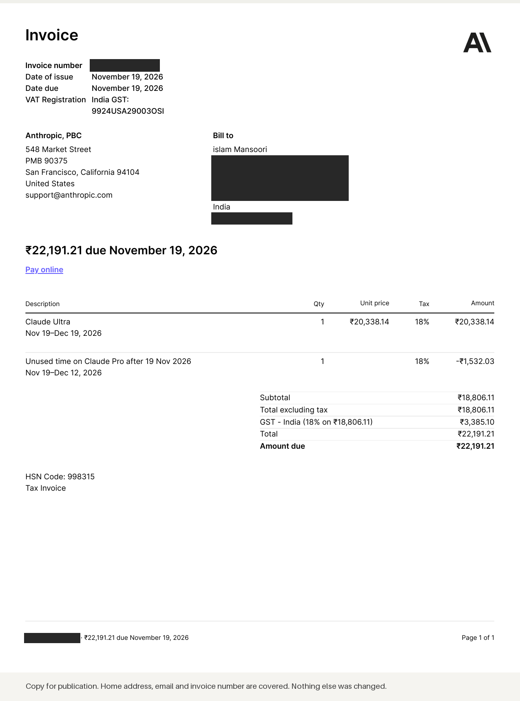

# Where model-effort-router overlaps and where it differs

As of 26 November 2026, [model-effort-router](https://github.com/islamkmansoori/model-effort-router) works in a crowded field. The research counted **at least 45 public projects that pick a model for Claude Code work, and at least 20 that also pick an effort level**, so choosing both is common. **Eight narrower things were not found in what was read**: its set of inputs (task labels, configured critical and risk paths, test and change-history facts of the files a task touches); a verdict of worker, environment or task read from a failed attempt's output; a stop when the same failure shows up on two models; a budget that lowers the starting model instead of halting work; a savings figure for the router's own choices kept apart from all model choice; a voluntary savings report with no telemetry, added up in public; a command that copies the router into a project for a whole team; and a public comparison of "jump" against "climb" retry rules on one set of runs. Each of the eight has a partial match in another project, and "not found" means not found on the public pages read, many of them read only by keyword-matched lines. The research also weighs against several of the project's own claims. Its benchmark has **21 tasks and one run per task and rung**, too few to support its specific numbers; its three headline findings were already public from larger studies; it has no control that retries the same rung; its savings method assumes another model would use the same number of tokens, which one public experiment found unreliable; and its config file has the same name as another hook's. The author of model-effort-router asked for this research and no person has checked it yet, so it is a first map and not an independent review.

## How to read this report

Every statement about another project says what its public page showed when it was read on 26 November 2026. Projects change, so check the linked page before you rely on a line. "Not found in what was read" means the pages that were read did not show the feature. It does not mean the feature does not exist. Many READMEs (a README is the front page of a repository) were read only by the lines that matched search words. "Search result only" means the project's own page was not opened. Some pages were read through a tool that summarises, so this report puts those pages in its own words and links them instead of quoting them. Numbers from other pages are as the research notes recorded them. Star counts (how many GitHub users bookmarked a repository) are as seen on 26 November 2026.

The report grades its own evidence in three steps. **Stronger** means the closest projects state the point plainly on pages that were read directly. **Medium** means the researchers ran searches aimed at finding a counter-example, but most pages were read by matched lines. **Weaker** means the point rests on the pages read, with no search aimed at it.

| Term | Meaning in this report |
|---|---|
| Model | The AI system that does the work. Claude Code offers several, among them Haiku, Sonnet and Opus. Sonnet costs less than Opus. |
| Effort | A setting that tells the model how much to think before it answers: low, medium, high, xhigh or max. More effort costs more. |
| Token | The unit in which model use is counted and priced. |
| Subagent | A helper that Claude Code starts to do one piece of a job. |
| Hook | A small script that Claude Code runs at a set moment, here just before a subagent starts. |
| Router | A tool that picks the model, and here also the effort, for a piece of work. |
| Rung, ladder | The router's ordered list of model and effort pairs: Sonnet medium, Sonnet high, Opus high, Opus xhigh. One pair is a rung. |
| Cascade, escalation | Try a cheap model first. Move to a stronger one only if the first attempt fails. |
| Baseline | What a saving is measured against, for example "everything on Opus". |
| API-equivalent dollars | What the same use would cost at list prices, even if the person pays a flat subscription. |
| Telemetry | Usage data that a tool sends to its maker by itself. |
| Proxy, gateway | A program that sits between the coding tool and the model provider and can redirect each request. |
| Classifier | A small model that sorts a request into a class such as "easy" or "hard". |
| SWE-bench Verified | A public set of real bug reports from open-source projects. Each has hidden tests, which the model never sees, that decide whether a fix works. |

## Short answer: 8 things not found elsewhere, 7 partly matched, 10 already common

The three tables below sort what model-effort-router does, as its README states it, by how much of it other projects were found to do. All rows about other projects are as read on 26 November 2026, and star counts are as seen on that date.

**Group 1. Not found elsewhere in what was read**

| What model-effort-router does | Closest other projects, and how close | Strength of "not found" |
|---|---|---|
| Scores a task from facts beyond its wording: labels, `**Critical:**` and `**Risk:**` lines, configured critical and risk paths that decide the choice outright, touched code without tests, often-changed files | [pi-codex-router](https://github.com/burggraf/pi-codex-router) (1 star) adds a capped number of points for file count, uncommitted changes, file paths named in the prompt and number of languages; its [routing docs](https://cdn.jsdelivr.net/npm/pi-codex-router@0.1.4/docs/routing.md) say these points cannot choose the model alone. [CoalTipple](https://github.com/TheColliery/CoalTipple) (9 stars) takes a size number from the caller and finds sensitive areas by keyword. [lsy041015/model-routing](https://github.com/lsy041015/model-routing) (4 stars) has [written rules](https://raw.githubusercontent.com/lsy041015/model-routing/HEAD/core/RULES.md) about file counts and tests that the main model applies by judgement | Medium. Two research lines searched for a counter-example. No source code was read |
| Reads the output of a failed attempt and names the cause as worker, environment or task. Only a worker failure earns a stronger model | The [SWE-bench harness](https://raw.githubusercontent.com/SWE-bench/SWE-bench/HEAD/swebench/harness/infra_failure.py) labels failures "environment" or "ambiguous" from log patterns, as advice only. [Harbor](https://raw.githubusercontent.com/harbor-framework/harbor/HEAD/src/harbor/models/job/config.py) sets retry rules by error type. [GSD Core](https://raw.githubusercontent.com/open-gsd/gsd-core/HEAD/docs/CONFIGURATION.md) splits soft failure, hard failure and quota. [superpowers](https://raw.githubusercontent.com/obra/superpowers/HEAD/skills/subagent-driven-development/references/handling-reports.md) lists four causes that the controlling model judges. [AutoMode](https://github.com/mralexivy/AutoMode) (79 stars) leaves environment and flaky-test failures out of its learning | Medium. About 40 orchestration projects and the router pages were read. No code-level search was done |
| Stops climbing when the same failure appears on two different models | Checks for repeated errors inside one run: [ralph-claude-code](https://github.com/frankbria/ralph-claude-code), [escalation-governor](https://hermes-agent.nousresearch.com/marketplace/escalation-governor), the OpenHands stuck detector ([docs index](https://docs.openhands.dev/llms.txt)). NVIDIA NeMo Switchyard does the opposite: repeated identical failures force a move to the stronger model ([LiteLLM post](https://docs.litellm.ai/blog/switchyard-tool-aware-routing)) | Weaker. Rests on the pages read; no search aimed at this point |
| Past 80% of a daily budget, starts ordinary subagents on the cheap rung. Critical and risky tasks and retries are not capped | [CoalTipple](https://github.com/TheColliery/CoalTipple) drops to the next tier when a usage limit is hit, but never below a sensitive task's minimum tier. [LiteLLM budget routing](https://docs.litellm.ai/docs/proxy/provider_budget_routing) skips providers that are over budget. [claude-code-tokenbudget](https://github.com/outbit/claude-code-tokenbudget) (2 stars) blocks new prompts on daily, weekly and monthly token limits. [BudgetClaw](https://github.com/RoninForge/budgetclaw) (8 stars) stops the Claude Code process. [CodeBurn](https://github.com/getagentseal/codeburn) (11,921 stars) can warn a session at $5 and stop it at $15 | Medium. About 40 tracker READMEs were scanned by keyword and one search was aimed at it |
| Reports what the router's own choices saved (each routed subagent against the model that started it) apart from what all model choice saved | [Larridin Router](https://larridin.com/router/) (commercial) compares each request with the model the developer asked for. [better-model](https://github.com/talkstream/better-model) (3 stars) shows main agent and subagent dispatch apart; its savings are modelled ([README](https://cdn.jsdelivr.net/npm/better-model/README.md)). [TokenWise](https://github.com/CodeShuX/tokenwise) (6 stars) logs only the subagents it routed, against an all-Opus baseline. [LiteLLM](https://docs.litellm.ai/docs/proxy/auto_routing) records a saving per request, net of its classifier's cost | Medium. Four searches were aimed at it, plus the keyword scan |
| Prints an anonymous savings summary and a ready-filled link. Nothing is sent unless the person posts it. A daily job adds the posts into a public total | [RTK community pipelines](https://www.rtk-ai.app/pipelines/): authors publish their own benchmark figures through a reviewed submission, and no total is added up. [llama.cpp discussion 4167](https://github.com/ggml-org/llama.cpp/discussions/4167): people paste results into a GitHub Discussion and a maintainer adds them to a table by hand. [viberank](https://github.com/sculptdotfun/viberank) (121 stars) and [tokscale](https://github.com/junhoyeo/tokscale) (5,915 stars) take voluntary submissions to a hosted leaderboard that ranks usage, not savings | Medium. Five searches were aimed at it, plus the keyword scan |
| `share` copies the router and its hooks into the project, so everyone who opens the project is routed with nothing to install | [stas4000/claude-subagent-router](https://github.com/stas4000/claude-subagent-router) (10 stars) is installed by hand into the project folder, so a commit would carry it. [better-model](https://registry.npmjs.org/better-model) writes agents and a rules block into the project, with no router code. [gearbox](https://github.com/Adityaraj0421/gearbox) (17 stars) copies its routing policy only. [0dust/ClaudeRouter](https://github.com/0dust/ClaudeRouter) (5 stars) shares a config file by commit | Weaker. READMEs were read by matched lines and plugin marketplaces were not crawled |
| Compares "jump to the next model" with "climb one rung at a time" on the same published runs | [Anthropic's cost guide](https://platform.claude.com/docs/en/about-claude/models/optimizing-for-cost-and-intelligence.md) compares low-then-high with medium-then-high effort on one model. [arXiv 2610.34491](https://arxiv.org/abs/2610.34491) tests lowest effort first, then one retry at the highest. [Darwin Cascade](https://raw.githubusercontent.com/ruvnet/agent-harness-generator/main/submissions/swe-bench-lite/darwin-glm-opus-cascade/REPORT.md) publishes numbers for one cheap-then-strong rule | Medium. 22 search queries were run on the benchmark questions |

**Group 2. Partly matched elsewhere**

| What model-effort-router does | Closest other projects, and what still differs | Strength of the evidence |
|---|---|---|
| A hook sets both model and effort on each subagent as it starts | [tzachbon/claude-model-router-hook](https://github.com/tzachbon/claude-model-router-hook) (116 stars) routes subagent starts with the same kind of hook; its README does not say the hook writes an effort value. [stas4000/claude-subagent-router](https://github.com/stas4000/claude-subagent-router) swaps the call to one of three ready-made agents, each with a fixed model and effort. [dominicrico/jev-router](https://github.com/dominicrico/jev-router) (20 stars) picks a model and effort for each subagent from its description ([options file](https://raw.githubusercontent.com/dominicrico/jev-router/HEAD/OPTIONS.md)) | Medium. Rests on README wording |
| Uses the repository at all as an input | [pi-codex-router](https://github.com/burggraf/pi-codex-router) does, within a cap. Two research efforts do: a trained router with read-only access to the code ([Applied Compute](https://www.appliedcompute.com/research/agentic-model-router)) and a proposal that uses code-health measures ([arXiv 2604.07494](https://arxiv.org/abs/2604.07494)) | Medium |
| Checks before spending whether the task is ready: vague acceptance criteria, an open question, or no criteria | [IssueReady](https://github.com/whyiug/issueready) (0 stars) does a local, fixed-rule check of whether a GitHub issue is ready; it stands alone and is not tied to a router. [spec-kit](https://raw.githubusercontent.com/github/spec-kit/HEAD/templates/commands/clarify.md) (151,474 stars), [oh-my-openagent](https://raw.githubusercontent.com/code-yeongyu/oh-my-openagent/HEAD/docs/guide/orchestration.md) and [GSD Core](https://github.com/open-gsd/gsd-core) (11,862 stars) use a model or an agent to question the spec or check the plan | Stronger for "the idea is widespread"; medium for "not found tied to a router" |
| Keeps an outcome log and prints suggested rule changes for a person to apply | [IuriiTurok/auto-model-router](https://github.com/IuriiTurok/auto-model-router) (3 stars) has a report command that offers tweaks drawn from its log. [AutoMode](https://github.com/mralexivy/AutoMode) and [rightsize](https://github.com/archid21/rightsize) (52 stars) change their own rules automatically. [ruflo](https://raw.githubusercontent.com/ruvnet/ruflo/HEAD/plugins/ruflo-intelligence/README.md) says it routes with learned patterns | Medium. The research lines disagree: one found no printed rule suggestions, another found IuriiTurok's |
| Publishes a benchmark of ways of choosing, run through Claude Code, with model and effort together and every run published | [cheap-ag](https://github.com/muaaz9329/cheap-ag) (345 stars) tests on SWE-bench Verified with and without the tool. [dominicrico/jev-router](https://github.com/dominicrico/jev-router) keeps its raw Claude Code runs in the repository. [retort](https://github.com/adrianco/retort) (211 stars) runs experiments over model and effort. None found reports cost per solved task for model, effort and a retry rule together through Claude Code | Medium |
| Bases its retry rule on its own published numbers | [Darwin Cascade](https://raw.githubusercontent.com/ruvnet/agent-harness-generator/main/submissions/swe-bench-lite/darwin-glm-opus-cascade/REPORT.md) does, self-published. [GSD Core](https://raw.githubusercontent.com/open-gsd/gsd-core/HEAD/docs/CONFIGURATION.md) and [superpowers](https://raw.githubusercontent.com/obra/superpowers/HEAD/skills/subagent-driven-development/SKILL.md) (327,188 stars) state retry rules with no evidence cited on the pages read | Medium |
| Explains each choice point by point | [CoalTipple](https://github.com/TheColliery/CoalTipple) prints a list of reasons. [Svelez97/claude-model-selection](https://github.com/Svelez97/claude-model-selection) (1 star) prints a reason line. Routers that use a classifier show the pick and a short reason, not a score | Medium |

**Group 3. Already common**

| What model-effort-router does | Examples of others that do it | Strength of the evidence |
|---|---|---|
| Picks an effort level as well as a model | About 20 Claude Code projects, among them [AutoMode](https://github.com/mralexivy/AutoMode), [alexei-led/claude-router](https://github.com/alexei-led/claude-router) (52 stars) and [rightsize](https://github.com/archid21/rightsize). Hosted routers: OpenRouter [Auto Router](https://openrouter.ai/docs/guides/routing/routers/auto-router) and [Auto Code](https://openrouter.ai/docs/guides/routing/routers/auto-code.md), and [Not Diamond Code](https://code.notdiamond.ai/docs/) | Stronger |
| Scores size or complexity with hand-written points | [LiteLLM](https://docs.litellm.ai/docs/proxy/auto_routing) (seven dimensions), [ClawRouter](https://github.com/BlockRunAI/ClawRouter) (fifteen; 6,670 stars), [pi-codex-router](https://github.com/burggraf/pi-codex-router) | Stronger |
| Starts cheap and moves up after a failure | [gearbox](https://github.com/Adityaraj0421/gearbox), [jdogresorg/claude-model-router](https://github.com/jdogresorg/claude-model-router) (1 star), [GSD Core](https://raw.githubusercontent.com/open-gsd/gsd-core/HEAD/docs/CONFIGURATION.md), [NVIDIA NeMo Switchyard](https://github.com/NVIDIA-NeMo/Switchyard) (3,715 stars), [Anthropic's cost guide](https://platform.claude.com/docs/en/about-claude/models/optimizing-for-cost-and-intelligence.md), and research since [FrugalGPT](https://arxiv.org/abs/2305.05176) | Stronger |
| Reports spend against daily, weekly or monthly limits, with alerts | [claude-code-tokenbudget](https://github.com/outbit/claude-code-tokenbudget), [claude-powerline](https://github.com/Owloops/claude-powerline) (1,180 stars), [NadirClaw](https://github.com/NadirRouter/NadirClaw) (666 stars), Claude Code's own [gateway spend limits](https://code.claude.com/docs/en/claude-apps-gateway-spend-limits) | Stronger |
| Estimates savings as "the same tokens, priced on a baseline model" | [LiteLLM](https://docs.litellm.ai/blog/auto-router-production-savings), [TokenWise](https://github.com/CodeShuX/tokenwise), [jdogresorg/claude-model-router](https://github.com/jdogresorg/claude-model-router), [NadirClaw](https://github.com/NadirRouter/NadirClaw), [Token Optimizer](https://github.com/alexgreensh/token-optimizer) (3,160 stars) | Stronger |
| Publishes a benchmark | [AutoMode](https://github.com/mralexivy/AutoMode), [rightsize](https://github.com/archid21/rightsize), [cheap-ag](https://github.com/muaaz9329/cheap-ag); larger ones from [LangChain](https://langchain.com/blog/switchyard-agent-routing-benchmark), [Applied Compute](https://www.appliedcompute.com/research/agentic-model-router) and [OpenRouter](https://openrouter.ai/benchmarks/routers) | Stronger |
| Shows each pick and keeps a local log | [tzachbon/claude-model-router-hook](https://github.com/tzachbon/claude-model-router-hook), [stas4000/claude-subagent-router](https://github.com/stas4000/claude-subagent-router), [shaaz1000/claude-router](https://github.com/shaaz1000/claude-router) (4 stars) | Stronger |
| Reads Claude Code's local usage records, with no proxy and no account | [ccusage](https://github.com/ccusage/ccusage) (19,605 stars), [CodeBurn](https://github.com/getagentseal/codeburn), [Claude-Code-Usage-Monitor](https://github.com/Maciek-roboblog/Claude-Code-Usage-Monitor) (8,818 stars) | Stronger |
| Needs no installed packages and sends nothing out | [stas4000/claude-subagent-router](https://github.com/stas4000/claude-subagent-router) (Python standard library only), [CoalTipple](https://github.com/TheColliery/CoalTipple), [better-model](https://registry.npmjs.org/better-model) and [model-orchestrator](https://github.com/aunysillyme/model-orchestrator) (20 stars) state zero dependencies | Medium. Taken from README statements; no dependency files were read |
| Its benchmark's three headline findings: moving up after failure saves money, the top effort level rarely pays, task wording predicts difficulty poorly | [Anthropic's cost guide](https://platform.claude.com/docs/en/about-claude/models/optimizing-for-cost-and-intelligence.md), [arXiv 2610.34491](https://arxiv.org/abs/2610.34491), [SWE-Router](https://arxiv.org/abs/2607.00053) | Stronger. Larger studies were read |

## The field: at least 45 Claude Code pickers and five other kinds of neighbour

The closest neighbours are projects that choose a model for Claude Code work. As read on 26 November 2026, they fall into four groups: plugins that route each prompt of the main conversation, plugins and skills that route subagents, wrappers and local proxies that rewrite each request, and gateways that connect many providers. Most are small. The names collide: at least four repositories are called `claude-model-router`, five or more `claude-router`, and four `jev-router`. Counts such as "at least 45" are lower bounds, because GitHub's public search shows only the top results for each query. In the table, stars and last push are as seen on 26 November 2026.

| Project (as read on 26 November 2026) | Stars | Last push | What its README says it does | How it was read |
|---|---|---|---|---|
| [tzachbon/claude-model-router-hook](https://github.com/tzachbon/claude-model-router-hook) | 116 | 2026-09-02 | Routes prompts and subagent starts by local rules, with an optional Haiku call for unclear prompts | Full README |
| [stas4000/claude-subagent-router](https://github.com/stas4000/claude-subagent-router) | 10 | 2026-09-29 | A hook picks one of three builder agents for each sub-task, using the outside "Jev" classifier or offline rules | Full README |
| [dominicrico/jev-router](https://github.com/dominicrico/jev-router) | 20 | 2026-10-23 | Sends each prompt, step and subagent to the cheapest Claude model it judges able to do the job, and caps effort | Full README; options file by lines |
| [mralexivy/AutoMode](https://github.com/mralexivy/AutoMode) | 79 | 2026-11-21 | Picks model and effort for every prompt with two short Haiku judges, and learns from the user's own sessions | README lines |
| [alexei-led/claude-router](https://github.com/alexei-led/claude-router) | 52 | 2026-11-26 | Picks model and effort each turn with a classifier the user chooses | README lines |
| [archid21/rightsize](https://github.com/archid21/rightsize) | 52 | 2026-11-23 | Sends each prompt to the cheapest model and effort it judges able to do the job, and raises effort when the turn shows trouble | README lines |
| [Adityaraj0421/gearbox](https://github.com/Adityaraj0421/gearbox) | 17 | 2026-10-09 | Routes subagent work to the cheapest tier through a written policy the main model follows | README lines |
| [TheColliery/CoalTipple](https://github.com/TheColliery/CoalTipple) | 9 | 2026-11-23 | A model and effort router that grades by keywords and a size number and prints its reasons | README lines |
| [IuriiTurok/auto-model-router](https://github.com/IuriiTurok/auto-model-router) | 3 | 2026-11-13 | Routes each prompt, hands work to a cheaper worker subagent, keeps an audit log | README lines |
| [jdogresorg/claude-model-router](https://github.com/jdogresorg/claude-model-router) | 1 | 2026-03-27 | Logs token use and routes sub-tasks to the cheapest capable model through written instructions | README lines |
| [talkstream/better-model](https://github.com/talkstream/better-model) | 3 | 2026-05-21 | One command writes two agents and a routing block into the project; no hooks | npm README lines |
| [lsy041015/model-routing](https://github.com/lsy041015/model-routing) | 4 | 2026-11-24 | Twelve agents with a fixed model and effort each, for Claude Code and Codex CLI, with shared rules | README and rules by lines |
| [alexlicohen/claude-triage-layer](https://github.com/alexlicohen/claude-triage-layer) | 0 | 2026-11-25 | Seven subagent definitions and an instructions file; the main model classifies difficulty before it hands work on | README lines |
| [gargpratyush/jev-router](https://github.com/gargpratyush/jev-router) | 675 | 2026-09-19 | A wrapper that picks the model for each new user turn in Claude Code and Codex | README lines |
| [adarshmishra07/jcm-router](https://github.com/adarshmishra07/jcm-router) | 9 | 2026-09-17 | A local proxy that picks model and effort per message with the "Jev" classifier | README lines |
| [Manuele-T/claude-model-router](https://github.com/Manuele-T/claude-model-router) | 29 | 2026-11-25 | An experiment on whether handing work to cheaper models saves money, plus a routing skill | README lines |
| [muaaz9329/cheap-ag](https://github.com/muaaz9329/cheap-ag) | 345 | 2026-11-25 | A frontier model plans, a cheap third-party model writes the code, tests decide | README lines |
| [modu-ai/moai-adk](https://github.com/modu-ai/moai-adk) | 1,263 | 2026-11-26 | An agent harness in which the session's model and effort are picked once and every agent inherits them | README lines |

The large projects in this space are gateways, and they answer a different question: which provider and account serves a request. As read on 26 November 2026, with stars as seen on that date, examples are [claude-code-router](https://github.com/musistudio/claude-code-router) (38,377 stars), [CLIProxyAPI](https://github.com/router-for-me/CLIProxyAPI) (59,531 stars), [9router](https://github.com/decolua/9router) (32,873 stars), [OmniRoute](https://github.com/cheaper-inference/OmniRoute) (90,488 stars) and [cc-switch](https://github.com/farion1231/cc-switch) (157,401 stars). They overlap with model-effort-router only where they add routing by difficulty, as [Lynkr](https://github.com/Fast-Editor/Lynkr) (641 stars), [NadirClaw](https://github.com/NadirRouter/NadirClaw) and [ClawRouter](https://github.com/BlockRunAI/ClawRouter) do. Several more routers were seen in search results only and their features are not confirmed, for example a marketplace listing for [0xrdan/claude-router](https://www.claudepluginhub.com/plugins/0xrdan-claude-router), whose repository page returned "not found" on 26 November 2026.

Claude Code itself is the first other neighbour. As read on 26 November 2026, its documentation lets a person or a plugin set model and effort for a session, for an agent definition and for a single subagent call ([subagents](https://code.claude.com/docs/en/sub-agents.md)). The pages read describe no built-in feature that picks either from task difficulty. The automatic behaviours they describe are narrower: a mode that uses Opus for planning and Sonnet for the work, a switch to a fallback model on server errors, and an experimental advisor tool ([model configuration](https://code.claude.com/docs/en/model-config.md), [advisor](https://code.claude.com/docs/en/advisor.md)). A user request to make the automatic effort setting adapt to context was closed as not planned on 17 June 2026 by an inactivity bot, with no maintainer reply ([issue 60200](https://github.com/anthropics/claude-code/issues/60200)).

The second kind of neighbour is the general router, built for any application and not only for coding. As read on 26 November 2026, the older open-source ones pick a model only: [RouteLLM](https://github.com/lm-sys/RouteLLM) (5,739 stars, last push 10 August 2024) chooses between one strong and one weak model with a trained predictor, and [ClawRouter](https://github.com/BlockRunAI/ClawRouter) scores each request on fifteen dimensions. The newer ones go further. [LiteLLM](https://docs.litellm.ai/docs/proxy/auto_routing) (63,958 stars) offers six routing methods and can express effort levels as separate rungs. [NVIDIA NeMo Switchyard](https://github.com/NVIDIA-NeMo/Switchyard) reads what the agent's tools just did. OpenRouter's [Auto Router](https://openrouter.ai/docs/guides/routing/routers/auto-router) and [Auto Code](https://openrouter.ai/docs/guides/routing/routers/auto-code.md) and [Not Diamond Code](https://www.notdiamond.ai/blog/not-diamond-code-intelligent-model-routing-for-coding-agents) choose a model and an effort level, the last one behind a waitlist.

The third kind is the routing built into other coding agents. As read on 26 November 2026, automatic model choice per request is built into [Cursor](https://cursor.com/docs/cursor-router), [GitHub Copilot](https://docs.github.com/en/copilot/concepts/auto-model-selection), [Gemini CLI](https://raw.githubusercontent.com/google-gemini/gemini-cli/main/docs/cli/model.md), [Kilo Code](https://kilo.ai/docs/code-with-ai/agents/auto-model), [Devin Desktop and Windsurf](https://docs.devin.ai/desktop/adaptive.md), [Warp](https://docs.warp.dev/agents/inference/model-choice.md) and [Factory Droid](https://docs.factory.com/model-independence/factory-router). None of the pages read says that the built-in router chooses the effort level. That is "not stated", not "no".

The fourth kind is the orchestration and spec tool, which runs whole jobs with many agents. As read on 26 November 2026, with stars as seen on that date, examples are [superpowers](https://github.com/obra/superpowers) (327,188 stars), [spec-kit](https://github.com/github/spec-kit) (151,474 stars), [ruflo](https://github.com/ruvnet/ruflo) (82,473 stars), [oh-my-claudecode](https://github.com/Yeachan-Heo/oh-my-claudecode) (41,081 stars) and [GSD Core](https://github.com/open-gsd/gsd-core) (11,862 stars). Most assign the model by role or phase in a fixed table. model-effort-router can set the model for the subagents such tools start. It overlaps directly only with the model rules inside superpowers, GSD Core and oh-my-claudecode.

The fifth kind covers usage trackers, and public benchmarks and papers. As read on 26 November 2026, trackers such as [ccusage](https://github.com/ccusage/ccusage), [CodeBurn](https://github.com/getagentseal/codeburn), [Claude-Code-Usage-Monitor](https://github.com/Maciek-roboblog/Claude-Code-Usage-Monitor) and [tokscale](https://github.com/junhoyeo/tokscale) read the same local usage records as model-effort-router. The most-starred savings tools, [RTK](https://github.com/rtk-ai/rtk) (87,911 stars), [Headroom](https://github.com/headroomlabs-ai/headroom) (80,919 stars) and [caveman](https://github.com/JuliusBrussee/caveman) (123,015 stars), save by shortening text, not by choosing models. The benchmarks and papers are named in the sections that use them.

## Evidence by area

Each part below states what the README says the project does, what was found elsewhere, and how strong the evidence is.

### Choosing model and effort is common; the inputs are the difference

model-effort-router's README says a hook reads the task, its labels and the repository before a subagent starts, then sets Sonnet or Opus and an effort level of medium, high or xhigh. As read on 26 November 2026, **choosing effort together with the model is common**. About 20 of the Claude Code projects read do it, for example [AutoMode](https://github.com/mralexivy/AutoMode) and [alexei-led/claude-router](https://github.com/alexei-led/claude-router) for each prompt, and [dominicrico/jev-router](https://raw.githubusercontent.com/dominicrico/jev-router/HEAD/OPTIONS.md) for each subagent. Hosted routers do it too. OpenRouter's [Auto Router](https://openrouter.ai/docs/guides/routing/routers/auto-router) picks a model and a reasoning effort for each request, and [Not Diamond Code](https://www.notdiamond.ai/blog/not-diamond-code-intelligent-model-routing-for-coding-agents) does so for each step of a coding session.

Doing it at the moment a subagent starts is partly matched. As read on 26 November 2026, [tzachbon/claude-model-router-hook](https://github.com/tzachbon/claude-model-router-hook) routes subagent starts with the same kind of hook and lets an explicit model win; its README does not say the hook writes an effort value. [stas4000/claude-subagent-router](https://github.com/stas4000/claude-subagent-router) rewrites the call to one of three ready-made builder agents (Sonnet high, Sonnet xhigh, Opus xhigh), so the effort comes with the agent. Several others rely on written instructions that the main model has to follow. [gearbox](https://github.com/Adityaraj0421/gearbox) reports that its own log once showed 28 delegations in a row that did not use its agents. In other coding agents the subagent inherits the parent's model and effort by default, as the docs of [Codex](https://learn.chatgpt.com/docs/agent-configuration/subagents.md), [opencode](https://opencode.ai/docs/agents/) and [Amp](https://ampcode.com/docs/models-and-subagents) say.

The inputs are where the difference lies. As read on 26 November 2026, **every Claude Code picker that states its inputs decides from the wording of the prompt or brief**. [stas4000/claude-subagent-router](https://github.com/stas4000/claude-subagent-router) sees a short description and the first 1,000 characters of the brief. [Svelez97/claude-model-selection](https://github.com/Svelez97/claude-model-selection) classifies from the message alone and does not read files. [shaaz1000/claude-router](https://github.com/shaaz1000/claude-router) scores only what the person wrote. The nearest cases are a size number that the caller passes to [CoalTipple](https://github.com/TheColliery/CoalTipple), written rules about file counts and tests in [lsy041015/model-routing](https://raw.githubusercontent.com/lsy041015/model-routing/HEAD/core/RULES.md), and a check of the changed lines after the work in [gearbox](https://github.com/Adityaraj0421/gearbox).

Outside Claude Code, one small router does read the repository. As read on 26 November 2026, [pi-codex-router](https://github.com/burggraf/pi-codex-router) (1 star, last push July 2026) adds up to 30 points for file count, uncommitted changes, file paths in the prompt and number of languages, and its [docs](https://cdn.jsdelivr.net/npm/pi-codex-router@0.1.4/docs/routing.md) say those points only adjust the score. model-effort-router made the opposite choice: a configured critical path decides the rung outright. None of the pages read uses task labels, configured critical or risk paths, or test and change-history facts of the touched files. The author of the retired [switchboard](https://github.com/ruban-24/switchboard) (18 stars) gave a reason that points the same way: its closing note says a task's difficulty depends heavily on the surrounding code.

Strength of the evidence: medium. Two research lines ran GitHub and web searches for a counter-example. The "decides from wording" finding covers only projects whose README states its inputs, and no source code was read.

### Readiness checks are widespread; a fixed-rule check tied to a router is rare

The README says every score also reports whether the task is ready. It flags vague acceptance criteria (the conditions that say when a task is done), an open question, or no criteria at all. This is advice and never changes the model.

As read on 26 November 2026, no coded check of this kind was found among the Claude Code model pickers, and a GitHub repository search for the idea returned no results. Three pickers state the idea as a written rule. The [rules file of lsy041015/model-routing](https://raw.githubusercontent.com/lsy041015/model-routing/HEAD/core/RULES.md) tells the main model not to hand work on without a check that can be run. [model-orchestrator](https://github.com/aunysillyme/model-orchestrator) ships a task-brief template. [vimoxshah/claude-router](https://github.com/vimoxshah/claude-router) (7 stars) sends a task to an advisor after two failures if the spec is unclear.

Among spec and orchestration tools the idea is well covered. As read on 26 November 2026, [spec-kit](https://raw.githubusercontent.com/github/spec-kit/HEAD/templates/commands/clarify.md) has a step in which a model asks up to five questions about unclear areas before planning, and its scan covers whether acceptance criteria can be tested and whether adjectives are vague. In [oh-my-openagent](https://raw.githubusercontent.com/code-yeongyu/oh-my-openagent/HEAD/docs/guide/orchestration.md) (71,135 stars) a consultant agent looks for ambiguities and missing acceptance criteria before the plan is written. [GSD Core](https://raw.githubusercontent.com/open-gsd/gsd-core/HEAD/docs/CONFIGURATION.md) has a plan checker, and [OpenSpec](https://raw.githubusercontent.com/Fission-AI/OpenSpec/HEAD/docs/commands.md) shows which parts of a change are ready or blocked. **[IssueReady](https://github.com/whyiug/issueready) (0 stars) is the nearest in form**: it judges locally and by fixed rules whether a GitHub issue is ready for a person or a coding agent, and it never runs an agent. It stands alone and is not tied to a router. A research paper supports the idea: it builds 32 criteria and finds that merged pull requests come from issues that are shorter, well scoped and carry clear guidance ([arXiv 2512.21426](https://arxiv.org/abs/2512.21426)).

So the idea is not new. The form is the difference: fixed rules, attached to the routing step, printed as advice with the score. spec-kit and OpenSpec improve the spec with a model and a person; model-effort-router only flags. Strength of the evidence: stronger for "the idea is widespread", because those files were read directly; medium for "not found tied to a router".

### Two-way failure splits exist; the three-way verdict and the two-model stop were not found

The README says the `cause` command reads the failing output and suggests whose failure it was. Environment evidence, such as a missing module or a full disk, wins over task evidence, which wins over a failed test. Only a worker failure earns a stronger model. The same failure on two different models earns no further step, and after two retries the router says to ask a person.

As read on 26 November 2026, separating "the environment broke" from "the fix was wrong" exists in the two main benchmark harnesses. The [SWE-bench harness](https://raw.githubusercontent.com/SWE-bench/SWE-bench/HEAD/swebench/harness/infra_failure.py) (version 5.0.1) uses log patterns to label failures as environment or as ambiguous, and its source says the label is advisory. [Harbor](https://raw.githubusercontent.com/harbor-framework/harbor/HEAD/src/harbor/models/job/config.py) decides for each error type whether to retry and whether to grade. Some orchestrators split failures as retry policy. [GSD Core](https://raw.githubusercontent.com/open-gsd/gsd-core/HEAD/docs/CONFIGURATION.md) retries a soft failure, shows a hard failure at once, and handles quota errors apart. [superpowers](https://raw.githubusercontent.com/obra/superpowers/HEAD/skills/subagent-driven-development/references/handling-reports.md) lists four causes for a blocked worker (missing context, needs more reasoning, too large, wrong plan), which the controlling model judges from the worker's report. [AutoMode](https://github.com/mralexivy/AutoMode) says failures caused by the environment or a flaky test do not count against a model. OpenRouter's [Auto Router](https://openrouter.ai/docs/guides/routing/routers/auto-router) switches models when signs such as a repeated error or failing tests point at the model.

**No project in what was read assigns "the task itself is unclear" as a third cause by fixed patterns and feeds the verdict into a retry decision.** As read on 26 November 2026, the nearest cases rely on judgement: the "wrong plan" cause in superpowers, and a paper on safety failures that splits underspecification, capability errors and harness errors ([arXiv 2606.19380](https://arxiv.org/abs/2606.19380)).

Moving up after a failure is common. As read on 26 November 2026, [gearbox](https://github.com/Adityaraj0421/gearbox) moves one tier after two failures with the same root cause, [jdogresorg/claude-model-router](https://github.com/jdogresorg/claude-model-router) retries once at the next tier, and GSD Core has an opt-in rule, off by default, that moves one tier up and is capped at one move. Switchyard's escalation router starts each task on the cheaper model and moves after two negative verdicts in a row ([LangChain post](https://langchain.com/blog/switchyard-agent-routing-benchmark)). Raising effort after trouble also exists: [rightsize](https://github.com/archid21/rightsize) raises effort when a turn shows repeated failures, and [Rajvardhman05/claude-model-router](https://github.com/Rajvardhman05/claude-model-router) (32 stars) escalates in the order verify, effort, model. One research line reported that it found no project raising effort on retry; another found these two. Treat effort on retry as partly matched.

The rule that the same failure on two models stops the climb has no counterpart in the pages read. Only one project was found that backs its retry rule with its own numbers. As read on 26 November 2026, [Darwin Cascade](https://raw.githubusercontent.com/ruvnet/agent-harness-generator/main/submissions/swe-bench-lite/darwin-glm-opus-cascade/REPORT.md) moves to the strong model only when the cheap one produces no change at all, and reports 154 of 300 tasks solved at $0.267 per task. It is self-published and was not independently checked. Strength of the evidence: medium for the three-way verdict, weaker for the two-model stop.

### Outcome logs: others retune themselves; printed rule suggestions are partly matched

The README says `record` adds one row per finished task and `summary` groups the rows and suggests rule changes, which a person then applies. As read on 26 November 2026, some routers go further and change their own rules. [AutoMode](https://github.com/mralexivy/AutoMode) starts a small share of tasks on a cheaper model or lower effort and keeps the cheaper start only when the user's own results hold up. [rightsize](https://github.com/archid21/rightsize) pauses a route that keeps missing. [IuriiTurok/auto-model-router](https://github.com/IuriiTurok/auto-model-router) has a report command that offers tweaks drawn from its log, which is the nearest thing found to model-effort-router's `summary`. [ruflo](https://raw.githubusercontent.com/ruvnet/ruflo/HEAD/plugins/ruflo-intelligence/README.md) says it records the routing outcome and routes with learned patterns; no measurement of the effect was found. The [coding-router](https://huggingface.co/experiential-labs/coding-router) model is fitted on measured benchmark outcomes, not on the user's own. [tzachbon/claude-model-router-hook](https://github.com/tzachbon/claude-model-router-hook) logs the model that was asked for and the model that actually ran.

The difference is that model-effort-router keeps its rules readable and leaves the change to a person. Its log also holds rework and review findings, which the learned routers read do not mention. Strength of the evidence: medium, and the research lines disagree on whether printed rule suggestions exist elsewhere.

### Budgets: many tools stop work; none was found that lowers the starting model by task

The README says `budget` reports today's, the week's and the month's spend in API-equivalent dollars against limits, with alerts at 75%, 90% and 100%. With the throttle on, the hook starts ordinary subagents on the cheap rung once the day's spend passes 80% of the daily limit. Critical and risky tasks and retries are never capped.

As read on 26 November 2026, reporting spend against limits is common, and so is acting on a limit. The usual actions are warn, block, pause or stop. [claude-code-tokenbudget](https://github.com/outbit/claude-code-tokenbudget) blocks new prompts on daily, rolling seven-day and monthly token limits. [BudgetClaw](https://github.com/RoninForge/budgetclaw) stops the Claude Code process and sends a phone alert. [burnstop](https://github.com/phuryn/burnstop) (10 stars) halts a run at a session cap. [agent-bill-guard](https://github.com/quietmachine-org/agent-bill-guard) (0 stars) refuses the next request at a session or daily cap. Claude Code's own [gateway spend limits](https://code.claude.com/docs/en/claude-apps-gateway-spend-limits) cap each developer per day, week or month and warn at 75% and 95%.

**A budget response that starts ordinary work on a cheaper model while leaving critical work alone was not found in what was read.** As read on 26 November 2026, the two nearest cases are [LiteLLM budget routing](https://docs.litellm.ai/docs/proxy/provider_budget_routing), which skips providers that are over budget, and [CoalTipple](https://github.com/TheColliery/CoalTipple), which drops to the next tier when a usage limit is hit but never below a sensitive task's minimum. The first switches provider, not model tier by task. The second reacts to a usage limit, not to a dollar budget. Strength of the evidence: medium.

### Savings: the method is common; the router-only figure was not found

The README says `savings` and `report` give two results. The first is the router's own choices: what the routed subagents cost against the same tokens on the model that started them. It can be negative. The second is all model choice: every reply against the same tokens on a baseline model. Both assume another model would have used the same number of tokens.

As read on 26 November 2026, **at least seven public projects estimate savings from model choice against a baseline**, so the general method is established. [TokenWise](https://github.com/CodeShuX/tokenwise) and [jdogresorg/claude-model-router](https://github.com/jdogresorg/claude-model-router) compare with "everything on Opus". [NadirClaw](https://github.com/NadirRouter/NadirClaw) compares with a premium model the user names. [Token Optimizer](https://raw.githubusercontent.com/alexgreensh/token-optimizer/HEAD/BENCHMARK.md) compares with the user's own mix of models from before the tool, and says the figure is estimated and does not show that the tool caused each choice. A [LiteLLM study](https://docs.litellm.ai/blog/auto-router-production-savings) re-prices the same tokens at its top-tier model: 272,876 requests, $11,736 spent against $23,985.

Separating the tool's own effect is rarer. As read on 26 November 2026, [Larridin Router](https://larridin.com/router/), a commercial product, compares each request with the model the developer asked for. [better-model](https://cdn.jsdelivr.net/npm/better-model/README.md) keeps main-agent and subagent figures apart and counts cases where the model that ran differs from its routing, but its savings are modelled. TokenWise logs only what it routed, against all-Opus. No open-source project was found that prices each routed subagent against the model that started it, or that publishes the two results as separate numbers. Strength of the evidence: medium. The scan covered about 40 projects and 12 search queries, and small repositories without the searched words would be missed.

### The voluntary public report: its pieces exist apart, the combination was not found

The README says `report` prints a short anonymous summary and a link. Nothing is sent until the person opens the link and publishes the post. A script adds the posts up once a day into a public page, and nobody verifies them.

As read on 26 November 2026, most comparable tools learn about their use through telemetry. It is on by default in [ccusage](https://ccusage.com/guide/telemetry) (one ping a day, nothing from the usage logs), [CodeBurn](https://github.com/getagentseal/codeburn), [Headroom](https://github.com/headroomlabs-ai/headroom), [caveman](https://github.com/JuliusBrussee/caveman) and [NadirClaw](https://github.com/NadirRouter/NadirClaw), whose telemetry includes estimated cost and tokens saved. It is opt-in in [RTK](https://www.rtk-ai.app/docs/resources/telemetry/), whose fields include tokens saved. Tools with no telemetry, such as [TokenWise](https://github.com/CodeShuX/tokenwise), [Token Meter](https://github.com/splunk/token-meter) (156 stars) and [burnstop](https://github.com/phuryn/burnstop), state no way of learning what their users save in total.

Pieces of the idea exist elsewhere. As read on 26 November 2026, [viberank](https://github.com/sculptdotfun/viberank) sends daily totals only and stores each machine's day once, so nothing counts twice. [tokscale](https://github.com/junhoyeo/tokscale) can preview a submission before sending. [RTK community pipelines](https://www.rtk-ai.app/pipelines/) label self-reported figures by how they were measured. The [llama.cpp discussion](https://github.com/ggml-org/llama.cpp/discussions/4167) gathers results that people post by hand. The combination of a ready-filled link, totals only, no telemetry and an automatic public total was not found. Strength of the evidence: medium.

### Benchmarks are common and most are larger; comparing ways of choosing through Claude Code is partly matched

The README says the benchmark ran 21 SWE-bench Verified tasks once on each of four rungs, 84 runs in all, and publishes every run. It compares 13 ways of choosing by tasks solved and cost per solved task, and it tunes rules on one half of the tasks and tests them on the other.

As read on 26 November 2026, other routers also publish benchmarks. [cheap-ag](https://github.com/muaaz9329/cheap-ag) tests on SWE-bench Verified with the official harness, with and without the tool. [dominicrico/jev-router](https://github.com/dominicrico/jev-router) keeps its raw Claude Code runs in the repository and reports where it loses: in one of its tests its default preset cost as much as Opus on average while plain Sonnet was 43% cheaper. [AutoMode](https://github.com/mralexivy/AutoMode) reports 45% lower cost on 30 coding tasks at the same pass rate. [rightsize](https://github.com/archid21/rightsize) reports matching Opus at up to 30% lower cost, and costing about 1.4 to 2 times as much as Sonnet alone when started from Sonnet. These are each author's own figures and none was re-run. [alexei-led/claude-router](https://github.com/alexei-led/claude-router) says plainly that its savings and answer quality are not measured.

Larger measurements exist outside Claude Code plugins. As read on 26 November 2026, [LangChain's test of Switchyard](https://langchain.com/blog/switchyard-agent-routing-benchmark) used 145 tasks with five runs each, [Applied Compute](https://www.appliedcompute.com/research/agentic-model-router) used 497 SWE-bench Verified tasks with three runs per model, and [Anthropic's cost guide](https://platform.claude.com/docs/en/about-claude/models/optimizing-for-cost-and-intelligence.md) reports Claude models by effort level on 478 problems. Among tools that let a person run their own comparison, [retort](https://dev.to/adrianco_54/retort-thinking-level-results-what-opus-actually-does-with-the-extra-time-55f7) published an effort sweep on two tasks and a [Claude Code benchmark script](https://muhammadusmangm.github.io/claude-code-best-practices/guides/benchmarks/) uses six tasks with three runs each. What appears particular to model-effort-router's harness is that it scores many ways of choosing on one shared, published set of runs through Claude Code. Strength of the evidence: medium.

### Install and team copy: two commands are the norm; self-copy was not found

The README gives a one-line install and a `share` command that copies the router (about 90 KB) and two hooks into the project. As read on 26 November 2026, the usual install for comparable plugins is two commands: add the marketplace, then install. One-command installs exist: [tzachbon/claude-model-router-hook](https://github.com/tzachbon/claude-model-router-hook) has a shell installer, and [better-model](https://registry.npmjs.org/better-model) and [model-orchestrator](https://github.com/aunysillyme/model-orchestrator) each install with one `npx` command.

No project read has a command that copies the router itself into the project. As read on 26 November 2026, several get part of the effect: [stas4000/claude-subagent-router](https://github.com/stas4000/claude-subagent-router) lives in the project folder after a manual install, [gearbox](https://github.com/Adityaraj0421/gearbox) copies its policy file, and [0dust/ClaudeRouter](https://github.com/0dust/ClaudeRouter) and [tzachbon/claude-model-router-hook](https://github.com/tzachbon/claude-model-router-hook) read a config file from the project. Claude Code's own project scope does not remove the install step: its [docs](https://code.claude.com/docs/en/plugins/install.md) say each collaborator still runs the install once per copy of the repository.

On network use, the dividing line is whether task text goes to an outside classifier. As read on 26 November 2026, [dominicrico/jev-router](https://github.com/dominicrico/jev-router) and [alexei-led/claude-router](https://github.com/alexei-led/claude-router) send prompt text to the classifier the user chose, while the local-rules group ([shaaz1000/claude-router](https://github.com/shaaz1000/claude-router), [CoalTipple](https://github.com/TheColliery/CoalTipple), stas4000 without a key) sends nothing, as model-effort-router does. Strength of the evidence: weaker. READMEs were read by matched lines, plugin marketplaces were not crawled, and model-effort-router's one-line install form was not seen in any other README and was not checked against Claude Code's documentation.

## What others do that model-effort-router does not

model-effort-router routes subagents only, uses Claude models only, decides by fixed rules, and decides once before a subagent starts and again on a retry. The table lists what other projects were found to do beyond that. All rows are as read on 26 November 2026.

| What others do | Examples |
|---|---|
| Route the main conversation, for each prompt and each step | [dominicrico/jev-router](https://github.com/dominicrico/jev-router) picks per prompt, per step and per subagent. [AutoMode](https://github.com/mralexivy/AutoMode) can change the model in the middle of a chat |
| Protect the prompt cache (a stored copy of the conversation that makes later requests cheaper, lost when the model changes) | [xafold/jev-router](https://github.com/xafold/jev-router) (6 stars) does not switch when that would discard the cache. OpenRouter's [Auto Router](https://openrouter.ai/docs/guides/routing/routers/auto-router) holds back on switches for the same reason |
| Judge the task with a classifier or a trained router | [alexei-led/claude-router](https://github.com/alexei-led/claude-router) lets the user choose the classifier. [Cursor Router](https://cursor.com/blog/router) was trained on more than 600,000 live requests |
| Change model during a run, from what the agent's tools are doing | [Switchyard through LiteLLM](https://docs.litellm.ai/blog/switchyard-tool-aware-routing) scores recent tool calls each turn. [LiteLLM subtask routing](https://docs.litellm.ai/blog/subtask-type-routing) labels each turn explore, implement or verify |
| Use other providers, open-weight and local models | [claude-code-router](https://github.com/musistudio/claude-code-router), [model-relay](https://github.com/cablate/model-relay) (114 stars), [cheap-ag](https://github.com/muaaz9329/cheap-ag), [LiteLLM](https://github.com/BerriAI/litellm) |
| Work in other coding tools | [lsy041015/model-routing](https://github.com/lsy041015/model-routing) covers Claude Code and Codex CLI. [agent-router](https://github.com/nidhi-singh02/agent-router) (124 stars) picks among several coding agents. [ccusage](https://github.com/ccusage/ccusage) reads 20 agents |
| Fail over when a usage limit or provider error hits, and show subscription plan limits | [model-relay](https://github.com/cablate/model-relay) hands the request to a backup provider. [CodeBurn](https://github.com/getagentseal/codeburn) and [Claude-Code-Usage-Monitor](https://github.com/Maciek-roboblog/Claude-Code-Usage-Monitor) show the 5-hour and weekly plan limits |
| Live interface and dashboards | [alexei-led/claude-router](https://github.com/alexei-led/claude-router) draws a band above the prompt. [rightsize](https://github.com/archid21/rightsize) shows buttons. [claude-code-router](https://github.com/musistudio/claude-code-router) has request logs with cost estimates |
| Tune their own rules automatically | [AutoMode](https://github.com/mralexivy/AutoMode), [rightsize](https://github.com/archid21/rightsize) |
| Check results with a separate verifier or reviewer | [gearbox](https://github.com/Adityaraj0421/gearbox) has a verifier agent review the changes. [superpowers](https://raw.githubusercontent.com/obra/superpowers/HEAD/skills/subagent-driven-development/SKILL.md) requires two review verdicts per task. [NadirClaw](https://github.com/NadirRouter/NadirClaw) verifies the output before it moves up |
| Detect a stuck worker while it runs | [ralph-claude-code](https://github.com/frankbria/ralph-claude-code) (9,741 stars) has a circuit breaker. [Gas Town](https://github.com/gastownhall/gastown) (18,908 stars) has a watcher role. model-effort-router reads the output after the attempt ends |
| Run the whole job: roles, isolated work areas, memory, merge queues | [Gas Town](https://github.com/gastownhall/gastown), [claude-squad](https://github.com/smtg-ai/claude-squad) (8,871 stars), [Beads](https://github.com/gastownhall/beads) (29,114 stars) |
| Write and sharpen the spec itself | [spec-kit](https://github.com/github/spec-kit), [OpenSpec](https://github.com/Fission-AI/OpenSpec) (75,796 stars), [BMAD-METHOD](https://github.com/bmad-code-org/BMAD-METHOD) (55,780 stars) |
| Treat a flaky test or a bad run as its own kind of failure | [open-swe](https://github.com/langchain-ai/open-swe) (11,265 stars) reruns only jobs it has evidence are flaky. A paper names "bad run" as a class ([arXiv 2611.08285](https://arxiv.org/abs/2611.08285)) |
| Measure quality next to cost in daily use | [Cursor](https://cursor.com/blog/router) measures how much generated code stays in the codebase. [TokenWise](https://github.com/CodeShuX/tokenwise) can run one task on several tiers and score the outputs |
| Hard stops, history past 30 days, team totals, prices kept current | [BudgetClaw](https://github.com/RoninForge/budgetclaw), [toktrack](https://github.com/mag123c/toktrack) (196 stars), [tokscale](https://github.com/junhoyeo/tokscale) |
| Let a person override in the prompt, or ask before a costly subagent runs | [dominicrico/jev-router](https://github.com/dominicrico/jev-router) and [tzachbon/claude-model-router-hook](https://github.com/tzachbon/claude-model-router-hook) accept prefixes typed in the prompt. [Svelez97/claude-model-selection](https://github.com/Svelez97/claude-model-selection) asks first |

Two points about scope follow from this table. As read on 26 November 2026, [jcm-router](https://github.com/adarshmishra07/jcm-router) reports from its own measurements that routing subagents saves money while routing a long-running main chat loses it, because the stored conversation is discarded on each model switch. That supports routing subagents only. It also means a person who rarely starts subagents gets nothing from model-effort-router, while the per-prompt routers act on every message.

## What the research says against the project's own claims

### The benchmark is too small to support its specific numbers

The README states the limit itself: one run per task and rung, and "read them as a pilot". The research agrees and goes further. As read on 26 November 2026, a study that ran six setups ten times each on all 500 SWE-bench Verified tasks found that a single run's score moves by 2.2 to 6.0 points depending on which run is picked, and that about nine runs are needed to detect a 2-point gain ([arXiv 2602.07150](https://arxiv.org/html/2602.07150v2)). An independent analysis of a leaderboard with at least five tries per task found that 24 of 25 neighbouring pairs differ by an amount it calls noise ([LessWrong analysis](https://www.lesswrong.com/posts/GiPmLmmbT6DyrwYkH/terminal-bench-leaderboard-rankings-luck-or-skill)).

The research also did its own arithmetic on the README's counts. These figures are this research's calculations, not statements from any source. With 21 tasks, 14 solved means a true rate somewhere between 45% and 83%, and 20 solved means 77% to 99%. The two ranges overlap. The largest contrast in the benchmark, Sonnet medium against Opus high, sits at the edge of what a standard paired test accepts. Nothing smaller can be told apart: Sonnet medium and Sonnet high differ by one task, "rescued 1 of 7" has a range of 3% to 51%, and Opus high and Opus xhigh tie at 20. The **13% saving has no range at all**, because one more or one fewer Sonnet pass moves the $0.61 gap by roughly $0.20 to $0.40. On the held-out half, the tuned router ($1.23) did not beat the plain "jump" rule ($1.20). Thirteen ways of choosing were compared on the same 84 runs, which invites picking a winner by chance. The research's one-line placement is a pilot with every run published, whose direction agrees with larger studies, and whose specific numbers (13%, 1 of 7, 20 against 20) should not be quoted as measured effects.

### No arm retries the same rung, so part of the gain may be a second try

The README's table has no row that retries a failed task on the same model and effort. Other studies include one. As read on 26 November 2026, [arXiv 2610.34491](https://arxiv.org/html/2610.34491) reports for one model on one benchmark: low effort twice 43.8% solved, low then high 59.0%, high twice 64.2%. The research notes read this as showing that a plain second try already recovers some failures. A second paper finds that the same model often solves an issue in some runs and fails it in others, that retrying rescues only failures caused by a bad run, and that switching model per issue gained nothing on held-out runs ([arXiv 2611.08285](https://arxiv.org/abs/2611.08285)). With one run per cell, model-effort-router's benchmark cannot separate "Sonnet medium cannot solve this task" from "Sonnet medium failed this time".

### The three headline findings were already public from larger studies

As read on 26 November 2026, each headline finding had been published with more tasks. On moving up after failure, [Anthropic's cost guide](https://platform.claude.com/docs/en/about-claude/models/optimizing-for-cost-and-intelligence.md) reports that running Opus 5.5 at low effort and re-running only the failures at high solved about 97% of 478 problems for about $0.17 per task, against 95.3% for $0.29 with everything at high. [arXiv 2610.34491](https://arxiv.org/html/2610.34491) reports that lowest effort first with one retry at the highest matches or beats fixed top effort across eight models, with a median saving (the middle value across models) of 15.5% on its coding benchmark. On the top effort level, the same Anthropic page reports that xhigh scored about 1.4 points higher than high for 2.5 times the cost, and [a 36-problem public test](https://github.com/humanlayer/advanced-context-engineering-for-coding-agents/blob/main/benchmarking-new-models-on-slop-code-bench.md) found fewer passes for Opus 5.5 at xhigh than at medium, for about four times the cost. On task wording, [SWE-Router](https://arxiv.org/abs/2607.00053) argues that routers reading only the task description hit a floor, because similar issues can hide a small fix or a large one.

Two cautions follow. First, model-effort-router's 13% saving is at the low end of the published range. Second, with 21 tasks the benchmark could not have seen a 1.4-point gain even if it exists, so "Opus xhigh solved nothing Opus high did not" is "no effect detected", not "no effect". What the benchmark adds is narrower: the ladder across two models (Sonnet, then Opus) measured through Claude Code, many ways of choosing compared on one published set of runs, the hindsight bound of $2.70, and a harness others can rerun. Effort findings also expire. As read on 26 November 2026, [Anthropic's effort page](https://platform.claude.com/docs/en/build-with-claude/effort) advises starting at xhigh for Opus 4.7 and 4.8, while Opus 5.5 defaults to medium. The README does not name the exact model versions it tested.

### "Does not predict its difficulty well" is stronger than the larger studies support

The README says that reading a raw bug report "does not predict its difficulty well" and that neither the word rules nor the Haiku assessor picked out the hard issues. As read on 26 November 2026, a larger study measured this on SWE-bench Verified. Using the problem statement alone, its predictors scored 0.755 to 0.786 on a scale where 0.5 is a coin toss and 1.0 is perfect; adding the tests or the solution raised the score to 0.833 and 0.845 ([arXiv 2604.00594](https://arxiv.org/html/2604.00594)). So the text carries some signal. The research's wording for what the larger studies support is "predicted too weakly to pay for routing". With 21 tasks the benchmark cannot tell a predictor that scores 0.75 from a coin toss.

Two related results cut both ways. As read on 26 November 2026, [TwinRouterBench](https://arxiv.org/html/2605.18859) found that a rule-based router cost more than no routing ($172.56 against $54.73 on 100 tasks), while a trained router halved the cost. The README's own finding 5, where one word sent an easy task to Opus xhigh, is the same failure in small. And whether explicit human labels such as risk, critical path or size predict the need for a stronger model, which is the router's main bet, was not found measured anywhere.

### Published positions disagree with "start cheap, jump on failure"

As read on 26 November 2026, three sources take a different position. [claude-triage-layer](https://github.com/alexlicohen/claude-triage-layer) classifies each task before handing it on and calls a try-cheap-first ladder wasteful. [moai-adk](https://github.com/modu-ai/moai-adk) argues for one model and effort for the whole session and cites a leaderboard on which a stronger model at its lowest effort scored higher than a weaker one at its highest (58% against 54%) at one-sixteenth of the cost per task. [Anthropic's cost guide](https://platform.claude.com/docs/en/about-claude/models/optimizing-for-cost-and-intelligence.md) advises sweeping effort on one model before adding a second, and its data show Opus 5.5 at low effort about level with Sonnet 5.5 at high (87.4% against 87.6% solved, $0.12 against $0.11 per solved task).

That last point matters for the ladder. model-effort-router's four rungs skip Opus low and Opus medium, which are the vendor's cheapest strong option and its default. A ladder that starts on Opus low was not tested. The claim "jump, do not climb" also rests on one task in the benchmark. It is supported more by outside data, where the lower first rung was the cheaper policy, than by the project's own runs. A further position, in an [escalation skill of claude-night-market](https://raw.githubusercontent.com/athola/claude-night-market/HEAD/plugins/abstract/skills/escalation-governance/SKILL.md) (356 stars) as read on 26 November 2026, is that repeated failure suggests a wrong approach, so a stronger model should not follow without investigation. model-effort-router's cause check is one way to meet that concern.

### The task source and the cost figures have known problems

As read on 26 November 2026, OpenAI said on 23 February 2026 that it no longer evaluates on SWE-bench Verified. In its audit of 138 problems, at least 59.4% had tests that reject correct fixes, and every frontier model it tested could reproduce the original human fix, which suggests the models had seen the answers ([OpenAI post](https://openai.com/index/why-we-no-longer-evaluate-swe-bench-verified/)). If the cheap model has seen these fixes, its first-try pass rate, and with it the saving from starting cheap, would be higher than on private code. Against that, Sonnet medium solved only 14 of 21 here, which suggests the tasks are harder than average or were selected. The README does not say how the 21 were chosen. A separate control matters too: one study removed the repository's change history and network access and saw scores fall sharply ([arXiv 2610.34491](https://arxiv.org/html/2610.34491)). The research did not read the benchmark's own method files, so it cannot say whether the harness does this.

Costs are Claude Code's own estimates, and the README says so. As read on 26 November 2026, public cost figures of this kind have needed correction elsewhere: one leaderboard notes costs inflated by exactly two times for some models ([HAL](https://hal.cs.princeton.edu/swebench_verified_mini)), and a Claude Code benchmark guide corrected Opus costs that were overstated about three times ([guide](https://muhammadusmangm.github.io/claude-code-best-practices/guides/benchmarks/)). How closely Claude Code's estimate matches a bill was not found measured. Lastly, the benchmark moves up when the hidden tests fail. A real project has no hidden tests, as the README notes. A review of the field found that run tests are a reliable signal and a model judging its own tier's output is not ([review](https://web.stanford.edu/~shuhuiq/blog/review-routing-cascades.html)). The published savings, model-effort-router's included, are therefore upper limits for real work.

### The savings method rests on an assumption that others have measured to fail

Both savings figures assume another model would have used the same number of tokens, and the README says so. As read on 26 November 2026, one public experiment tested this kind of estimate against real runs. [Manuele-T/claude-model-router](https://github.com/Manuele-T/claude-model-router) reports that re-pricing delegated work at Opus rates suggested savings of 34% to 85%, while the real results ranged from 30% more expensive to 75% cheaper. The assumption is shared by most tools that use the method, and [LiteLLM](https://docs.litellm.ai/docs/proxy/auto_routing) states the same limit.

Three more points apply. The savings figure has no quality side, where stronger measurements pair cost with results on the same tasks: as read on 26 November 2026, [LangChain](https://langchain.com/blog/switchyard-agent-routing-benchmark) reports routing as 74% cheaper and 6 points less accurate. The README's 29% case-study figure uses an "everything on Opus" baseline, and the README itself says most of that choice was made by hand before the router existed. Posted savings reports are each person's own estimate and unverified; [viberank](https://github.com/sculptdotfun/viberank) shows what checking submitted numbers can look like, with cost floors and ceilings per model.

### The failure-cause rules differ from the SWE-bench harness on one point

The README treats a missing module as an environment failure. As read on 26 November 2026, the [SWE-bench harness](https://raw.githubusercontent.com/SWE-bench/SWE-bench/HEAD/swebench/harness/infra_failure.py) files a missing module as ambiguous, because a bad change can cause it as well as a broken environment. model-effort-router also has no class for a flaky test. Research warns that naming a cause automatically is hard: the best method in one study found the responsible agent 53.5% of the time and the failing step 14.2% of the time ([arXiv 2505.00212](https://arxiv.org/abs/2505.00212)).

### One README sentence about other routers is out of date

The README says most routers, "for example claude-model-router, Jev-Router, RouteLLM", judge difficulty from the wording of a prompt or learn it from preference data. As read on 26 November 2026, that fits [RouteLLM](https://github.com/lm-sys/RouteLLM) and [ClawRouter](https://github.com/BlockRunAI/ClawRouter). It leaves out two newer kinds: routers that read what the agent's tools are doing ([Switchyard](https://github.com/NVIDIA-NeMo/Switchyard)), and hosted routers that choose effort as well as model (OpenRouter [Auto Code](https://openrouter.ai/docs/guides/routing/routers/auto-code.md), [Not Diamond Code](https://code.notdiamond.ai/docs/)). The name "Jev-Router" is also unclear. OpenRouter's [Jev Router](https://openrouter.ai/docs/guides/routing/routers/jev-router.md) selects a model and a reasoning effort for each request, [dominicrico/jev-router](https://github.com/dominicrico/jev-router) picks model and effort and publishes its raw benchmark runs, and four repositories carry the name. The README may mean a different project of the same name.

### The config file name is shared with another hook

model-effort-router reads `.claude/model-router.json`. As read on 26 November 2026, [tzachbon/claude-model-router-hook](https://github.com/tzachbon/claude-model-router-hook) reads a file of the same name, globally or in one project, with different settings inside. Both tools hook the start of a subagent. tzachbon's README warns: "If another `PreToolUse` hook rewrites the same spawn, Claude Code's undocumented merge order decides which rewrite wins." A machine with both installed would have two tools reading one file and two hooks rewriting one call. This was not tested.

One smaller point concerns the hook itself. The README says the hook was checked live. As read on 26 November 2026, the current [hooks reference](https://code.claude.com/docs/en/hooks.md) says a hook can replace a tool's inputs, which agrees. Two older bug reports saying such a rewrite was ignored for subagent calls were seen in search results only, shown as closed ([mirror of one report](https://claudeissues.com/issue/39814-pretooluse-hook-updatedinput-silently-ignored-for-agent-tool)). The [subagents page](https://code.claude.com/docs/en/sub-agents.md) says the per-call effort setting needs Claude Code v2.1.292 or later, which the README does not mention.

## Open questions the research raised for the project

The statements about other projects in this table are as read on 26 November 2026. The sections above give the detail.

| Question | Why it came up |
|---|---|
| What happens when model-effort-router and [tzachbon/claude-model-router-hook](https://github.com/tzachbon/claude-model-router-hook) are both installed? | Both read `.claude/model-router.json` and both rewrite subagent starts. The outcome was not tested |
| Which projects does the README mean by "Jev-Router" and "claude-model-router", and is the sentence still true? | Several repositories share each name. OpenRouter's [Jev Router](https://openrouter.ai/docs/guides/routing/routers/jev-router.md) and [dominicrico/jev-router](https://github.com/dominicrico/jev-router) both choose effort as well as model |
| How many repeat runs would the benchmark need? | One run per task and rung cannot show run-to-run change. One study puts the need at about nine runs to detect a 2-point gain ([arXiv 2602.07150](https://arxiv.org/html/2602.07150v2)) |
| Would a same-rung retry arm change the "jump to Opus" result? | Two studies show that a plain second try recovers some failures ([arXiv 2610.34491](https://arxiv.org/html/2610.34491), [arXiv 2611.08285](https://arxiv.org/abs/2611.08285)) |
| How were the 21 tasks chosen, which exact model versions ran, and does the harness remove change history and block network access? | The README does not say, and the benchmark's own method files were not read |
| Should the ladder include Opus low and Opus medium? | [Anthropic's cost guide](https://platform.claude.com/docs/en/about-claude/models/optimizing-for-cost-and-intelligence.md) puts Opus low level with Sonnet high, and names Opus medium as the starting point for most agent work |
| Should finding 3 say "predicted too weakly to pay for routing", and should the Opus xhigh result say "no effect detected"? | A larger study finds some signal in the task text ([arXiv 2604.00594](https://arxiv.org/html/2604.00594)); 21 tasks cannot show a small effect |
| Should a missing module count as environment or as ambiguous, and is a flaky-test class needed? | The [SWE-bench harness](https://raw.githubusercontent.com/SWE-bench/SWE-bench/HEAD/swebench/harness/infra_failure.py) files a missing module as ambiguous. [open-swe](https://github.com/langchain-ai/open-swe) and one paper ([arXiv 2611.08285](https://arxiv.org/abs/2611.08285)) treat a flaky job or a bad run as its own class |
| Should the README state the minimum Claude Code version, and is the one-line install form documented? | The per-call effort setting needs v2.1.292 or later ([subagents page](https://code.claude.com/docs/en/sub-agents.md)). The install form was not checked against the docs |
| How does the router behave beside [superpowers](https://github.com/obra/superpowers), [GSD Core](https://github.com/open-gsd/gsd-core) or another tool that also sets the subagent's model? | Two layers would both set the model. Neither project's pages cover it and it was not tested |
| Do explicit labels and paths predict the need for a stronger model? | This is the router's main bet, and no measurement of it was found anywhere |
| Can the savings figure get a quality side, and can posted reports be checked? | The same-tokens assumption failed in one public experiment ([Manuele-T/claude-model-router](https://github.com/Manuele-T/claude-model-router)). Posted figures are unverified |
| Is a view of subscription plan limits needed, and should prices refresh? | [CodeBurn](https://github.com/getagentseal/codeburn) and [Claude-Code-Usage-Monitor](https://github.com/Maciek-roboblog/Claude-Code-Usage-Monitor) show 5-hour and weekly limits, and [tokscale](https://github.com/junhoyeo/tokscale) fetches current prices. The router uses dollars only and a shipped price list |
| What did this research not cover? | Closed products were mostly out of reach, no source code was read, plugin marketplaces were not crawled, and small repositories are certainly missing |

## How this research was done

This research was done on 26 November 2026 by Claude Fable 5.2 (Anthropic) running in Claude Code at extra-high effort, on the author's paid Claude Ultra subscription. It used five parallel research lines and one writer. The author of model-effort-router asked for it, so it is not an independent review. It used public pages only. No person has checked it yet. Many READMEs were read by keyword-matched lines and not in full. No source code was read and no benchmark was re-run. GitHub's public API limit meant some dates are missing. Corrections are welcome through [the repository's issues](https://github.com/islamkmansoori/model-effort-router/issues).

The model and the effort level were read from Claude Code's own records of the six runs: each shows the model `claude-fable-5-2` and the effort `xhigh`. Those records are on the author's computer and are not published.

### The invoice for the plan

The picture below is the author's invoice from Anthropic for the plan the research ran on. It shows the plan name (Claude Ultra), the billing period (19 November to 19 December 2026, which includes the day of the research) and the amount paid. The author's home address, email and the invoice number are covered. Nothing else was changed.

The invoice shows that the plan was paid for. It does not show that the findings are right. The evidence for each finding is the link beside it in the sections above.

## Conclusion

The research changes how the project is best described. Its headline, picking a model and an effort level, names the part that at least 20 other Claude Code projects and several hosted routers also do. The parts not found elsewhere are narrower and sit around that choice: what the router reads, what it does after a failure, what it does near a budget limit, how it counts its own effect, and how a team gets it. A reader comparing tools will see those only if the README leads with them, and each should be worded as "not found in the pages read".

The benchmark is in the reverse position. Its direction agrees with larger public studies, so outside evidence now carries its conclusions more than its own 84 runs do. Repeat runs, a same-rung retry arm and the two Opus rungs it skips would test the one result that was not found published elsewhere: Sonnet first and Opus on failure, measured through Claude Code. The router's main bet, that explicit labels and paths show when a stronger model is needed, was not found measured by anyone, so the project's own outcome log is where a new result could come from. Hosted routers that choose model and effort on every turn now aim at the same coding tools from outside. They act at a different moment, and the pages read do not show them using the inputs listed above.
